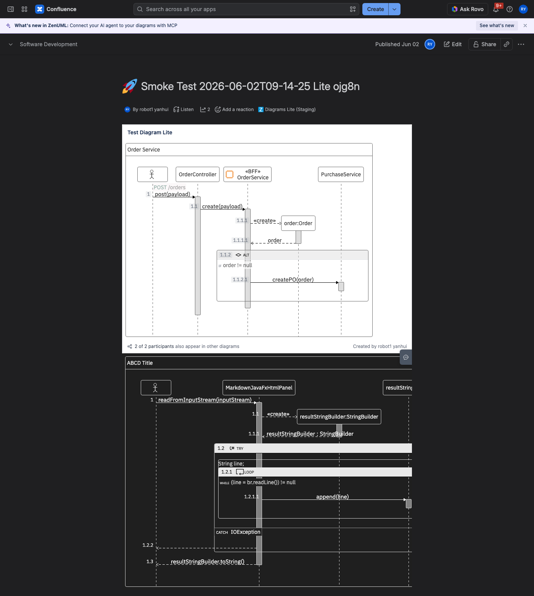

# 0004 — One canonical `theme-dark`, derived from measurements and gated by an APCA audit

Date: 2026-10-20
Status: Proposed. The structure (one canonical theme, aliases, PR A then PR B, parity test, three deferred
issues) was settled by the maintainer on 2026-10-20. Three resolutions of floor conflicts below (the chip
header, the opacity slots, the overlap policy) are the implementer's and await the maintainer's confirmation on
PR B. PR A `refactor/theme-colour-slots` (#491) is the slot refactor; PR B `feat/theme-dark` carries the theme,
the audit and this record.

## Context

`@zenuml/core` shipped three dark-ish looks: `src/themes/theme-dark.css` (dead: its `.zenuml.theme-dark`
selectors never matched the DOM, only its `:root` block leaked eight custom properties into every host
page), `theme-clean-dark` (indigo boxes on navy) and `theme-darcula` (an IDE palette). None was
measured against anything. Themes are public API: mermaid passes `theme` through, Confluence stores the
user's choice per page, the CLI takes `--theme`. The default theme carries no colour brand (decided
2026-10-04), so a dark theme has one job: the same diagram, legible on a dark surface.

The 2026-10-20 grill session fixed the structure (one canonical `theme-dark`; `theme-clean-dark` and
`theme-darcula` become aliases, removed in a later major; a slot refactor with zero pixel diff first; a
DOM/SVG palette parity test; three deferred issues). This ADR records how the values were derived and
the rule every future theme is accepted by.

## Decision

1. **Measure, do not pick.** Every `theme-default` colour role was rendered over the E2E corpus (33 HTML
   cases plus two audit cases), sampled from the screenshot, and expressed as an OKLCH lightness
   distance from its background. The dark theme starts from those distances mirrored onto a dark canvas
   and is then moved, role by role, until it clears an APCA floor. Nothing is hand-tuned; the script
   `scripts/theme-contrast/derive-dark.mjs` regenerates the palette and `apply-derived.mjs` writes it
   into `src/assets/tailwind.css` and `src/svg/themes.ts`.
2. **Canvas = nearest neutral to the Atlassian dark surface**, opaque: `#1f1f1f`
   (`oklch(23.9% 0 0)`; Atlassian `elevation.surface` is `#1F1F21`, VS Code `dark_modern` editor
   background is `#1F1F1F`). Opaque, not transparent: the Confluence macro iframe follows the page
   theme only when the page is dark (its body is transparent), the export path needs a colour to paint
   beside the diagram, and the audit needs a known composited background. Frame and participant
   boxes share the canvas, as in `theme-default`.
3. **Floors** (APCA-W3 0.1.9, absolute Lc, measured against the sampled background): text 75, text at
   12px or smaller 90, lines 45, fills 30. They are the acceptance rule for every theme from now on.
   `theme-default` does not meet them (it predates them) and is grandfathered against a recorded
   baseline: a role that was not under its floor when the baseline was taken, or one that drops more
   than 2 Lc below its recorded minimum, fails.
4. **Hue and chroma stay neutral.** Every slot is a grey. The only tinted values are the HTTP verbs in
   comments (`GET`, `POST`, `DELETE`), which keep a hue each but are separated by lightness so their
   Lc differs pairwise by at least 8 under deuteranopia and protanopia simulation (Machado 2009).
5. **Where the floors conflict, the surface changes shape, not the floor.**
   - A fragment header band that clears Lc 30 on this canvas is a mid grey (`#818181`) on which
     white reads Lc 72, so the band becomes a light chip with dark text (`#e9e9e9` / `#000`), light
     enough for its 12px sequence number to clear Lc 90. The divider note box is solved the same way
     (`#cfcfcf` / `#000`).
   - Comments (opacity 0.5) and guard text (opacity 0.65) cannot clear Lc 75 at any grey on this
     canvas (white at 0.5 reads Lc 36), so the opacity is a slot (`--opacity-comment`,
     `--opacity-guard`) that `theme-dark` sets to 1 and the hierarchy is carried by lightness.
   - The sequence-number badge and the comment code span keep no fill: `theme-default`'s tints read
     Lc 0 there, and a painted fill would have to become a light chip to carry text.
   - Lines that the lifeline layer draws over occurrence bars (the lifeline itself, a bar's border on
     a nested bar) are solved against the bar, not the frame.
6. **Overlaps are reported, not gated.** An element drawn over a surface it was not designed for (a short
   return label over an occurrence bar, a lifeline crossing a header chip, a separator crossing a bar)
   is a layout fact present in every theme; the audit lists them with their Lc. The gate applies to
   each role on the surfaces it is designed for.
7. **Aliases.** `.theme-clean-dark` and `.theme-darcula` share the `.theme-dark` declaration block; the
   SVG palette maps all three names to one object. `src/themes/theme-dark.css` is deleted.
8. **The audit gates CI.** `scripts/audit-theme-contrast.mjs` renders the corpus through both renderers
   in both themes at 1x and 2x, in forced-colors mode and on a host-matrix page (Atlassian, GitHub,
   VS Code backgrounds), walks every text node, line and fill, samples each background from the
   screenshot and fails the `theme-contrast` job in `cd.yml` on any `theme-dark` element under its
   floor or any new `theme-default` regression. The report is attached to the run.

## Evidence

All numbers below are generated by `scripts/theme-contrast/adr-tables.mjs` from the JSON files in
`docs/ux-research/evidence/theme-dark/` and spliced between `<!-- TABLES:x -->` markers by
`scripts/theme-contrast/adr-tables.mjs --write`; regenerate rather than edit.

### Measured `theme-default` (DOM renderer, 1x, the median item per role)

<!-- TABLES:measure -->
| role | n | fg | bg | fg OKLCH | ΔL from bg | Lc | floor |
| --- | --- | --- | --- | --- | --- | --- | --- |
| fill:canvas | 34 | #ffffff | #ffffff | oklch(100.0% 0.000 89.9) | +0.000 | 0.0 | — |
| fill:comment-code | 5 | #fbf8f9 | #ffffff | oklch(98.2% 0.003 354.7) | -0.018 | 0.0 | 30 |
| fill:divider-box | 2 | #fff5ad | #ffffff | oklch(96.2% 0.091 101.2) | -0.038 | 0.0 | 30 |
| fill:fragment-header | 59 | #efefef | #ffffff | oklch(95.2% 0.000 89.9) | -0.048 | 0.0 | 30 |
| fill:number-badge | 280 | #e1e2e3 | #efefef | oklch(91.2% 0.002 247.8) | -0.040 | 0.0 | 30 |
| fill:occurrence | 143 | #dedede | #ffffff | oklch(90.1% 0.000 89.9) | -0.099 | 17.0 | 30 |
| fill:participant-fill | 147 | #ffffff | #ffffff | oklch(100.0% 0.000 89.9) | +0.000 | 0.0 | — |
| line:arrow-head | 252 | #000000 | #ffffff | oklch(0.0% 0.000 0.0) | -1.000 | 106.0 | 45 |
| line:divider-line | 4 | #aaaa33 | #ffffff | oklch(71.6% 0.137 109.4) | -0.284 | 48.4 | 45 |
| line:fragment-border | 58 | #666666 | #ffffff | oklch(51.0% 0.000 89.9) | -0.490 | 78.8 | 45 |
| line:fragment-header-rule | 58 | #e5e7eb | #efefef | oklch(92.8% 0.006 264.5) | -0.025 | 0.0 | 45 |
| line:frame-border | 34 | #666666 | #ffffff | oklch(51.0% 0.000 89.9) | -0.490 | 78.8 | 45 |
| line:group-outline | 4 | #666666 | #ffffff | oklch(51.0% 0.000 89.9) | -0.490 | 78.8 | 45 |
| line:header-rule | 34 | #666666 | #ffffff | oklch(51.0% 0.000 89.9) | -0.490 | 78.8 | 45 |
| line:lifeline | 149 | #666666 | #ffffff | oklch(51.0% 0.000 89.9) | -0.490 | 78.8 | 45 |
| line:message-line | 190 | #000000 | #ffffff | oklch(0.0% 0.000 0.0) | -1.000 | 106.0 | 45 |
| line:occurrence-border | 143 | #666666 | #dedede | oklch(51.0% 0.000 89.9) | -0.390 | 59.4 | 45 |
| line:participant-border | 147 | #666666 | #ffffff | oklch(51.0% 0.000 89.9) | -0.490 | 78.8 | 45 |
| line:self-arrow | 62 | #000000 | #ffffff | oklch(0.0% 0.000 0.0) | -1.000 | 106.0 | 45 |
| line:separator | 20 | #e5e7eb | #ffffff | oklch(92.8% 0.006 264.5) | -0.072 | 11.8 | 45 |
| text:comment | 30 | #999999 | #ffffff | oklch(68.3% 0.000 89.9) | -0.317 | 54.6 | 75 |
| text:divider-text | 2 | #333333 | #fff5ad | oklch(32.1% 0.000 89.9) | -0.640 | 91.5 | 75 |
| text:fragment-condition | 40 | #595959 | #ffffff | oklch(46.4% 0.000 89.9) | -0.536 | 84.2 | 75 |
| text:fragment-label | 59 | #000000 | #efefef | oklch(0.0% 0.000 0.0) | -0.952 | 96.5 | 75 |
| text:fragment-section | 13 | #6f6f6f | #ffffff | oklch(54.2% 0.000 89.9) | -0.458 | 74.6 | 75 |
| text:group-title | 3 | #222222 | #ffffff | oklch(25.2% 0.000 89.9) | -0.748 | 102.9 | 75 |
| text:guard-keyword | 48 | #6b7280 | #ffffff | oklch(55.1% 0.023 264.4) | -0.449 | 73.6 | 90 |
| text:http-method | 4 | #84a29a | #fbf8f9 | oklch(68.7% 0.035 177.2) | -0.295 | 49.7 | 75 |
| text:message | 229 | #222222 | #ffffff | oklch(25.2% 0.000 89.9) | -0.748 | 102.9 | 75 |
| text:number | 280 | #6b7280 | #f0f1f2 | oklch(55.1% 0.023 264.4) | -0.407 | 65.1 | 90 |
| text:participant | 121 | #222222 | #ffffff | oklch(25.2% 0.000 89.9) | -0.748 | 102.9 | 75 |
| text:title | 8 | #222222 | #ffffff | oklch(25.2% 0.000 89.9) | -0.748 | 102.9 | 75 |
<!-- /TABLES:measure -->

### Host surfaces

<!-- TABLES:hosts -->
| host | token | value |
| --- | --- | --- |
| atlassian | `elevation.surface` | `#1F1F21` |
| atlassian | `elevation.surface.sunken` | `#18191A` |
| atlassian | `elevation.surface.raised` | `#242528` |
| atlassian | `elevation.surface.overlay` | `#2B2C2F` |
| atlassian | `color.text` | `#CECFD2` |
| atlassian | `color.text.subtle` | `#A9ABAF` |
| atlassian | `color.text.subtlest` | `#96999E` |
| atlassian | `color.border` | `#E3E4F21F` |
| atlassian | `color.border.bold` | `#7E8188` |
| atlassian | `color.background.neutral` | `#CECED912` |
| atlassian | `color.background.input` | `#242528` |
| github | `--bgColor-default` | `#0d1117` |
| github | `--bgColor-muted` | `#151b23` |
| github | `--fgColor-default` | `#f0f6fc` |
| github | `--fgColor-muted` | `#9198a1` |
| github | `--borderColor-default` | `#3d444d` |
| github | `--borderColor-muted` | `#3d444db3` |
| vscode | `dark_modern editor.background` | `#1F1F1F` |
| vscode | `dark_modern editor.foreground` | `#CCCCCC` |
| vscode | `dark_modern sideBar.background` | `#181818` |
| vscode | `dark_modern editorWidget.background` | `#202020` |
| vscode | `dark_modern widget.border` | `#313131` |
| vscode | `dark_modern panel.border` | `#2B2B2B` |
| vscode | `dark_modern descriptionForeground` | `#9D9D9D` |
| vscode | `dark_vs editor.background` | `#1E1E1E` |
| vscode | `dark_vs editor.foreground` | `#D4D4D4` |
| mermaid | `background` | `#333` |
| mermaid | `mainBkg` | `#1f2020` |
| mermaid | `textColor` | `#ccc` |
| mermaid | `mainContrastColor` | `lightgrey` |
| mermaid | `border1` | `#ccc` |
| mermaid | `border2` | `rgba(255, 255, 255, 0.25)` |
| mermaid | `lineColor` | `invert(background) = #ccc` |
| mermaid | `actorBkg` | `mainBkg = #1f2020` |
| mermaid | `actorBorder` | `border1 = #ccc` |
| mermaid | `actorTextColor` | `mainContrastColor = lightgrey` |
| mermaid | `signalColor` | `mainContrastColor` |
| mermaid | `labelBoxBkgColor` | `actorBkg` |
| mermaid | `noteBkgColor` | `#fff5ad` |
| mermaid | `activationBkgColor` | `secondBkg = lighten(mainBkg, 16)` |
| mermaid | `sequenceNumberColor` | `black` |
<!-- /TABLES:hosts -->

### Final tokens

<!-- TABLES:tokens -->
| token | value | OKLCH | measured against | Lc | floor | note |
| --- | --- | --- | --- | --- | --- | --- |
| `--color-bg-canvas` | `#1f1f1f` | oklch(23.9% 0.000 89.9) | — | — | — | nearest neutral to Atlassian elevation.surface #1F1F21 |
| `--color-bg-frame` | `#1f1f1f` | oklch(23.9% 0.000 89.9) | — | — | — | = canvas, as theme-default |
| `--color-bg-participant` | `#1f1f1f` | oklch(23.9% 0.000 89.9) | — | — | — | = frame, as theme-default (edge carried by the border) |
| `--color-bg-occurrence` | `#818181` | oklch(60.3% 0.000 89.9) | #1f1f1f | 33.3 | 30 | mirrored start #373737 |
| `--color-bg-comment-code` | `transparent` | — | — | — | — | no fill: theme-default's #f9f2f4 reads Lc 0 on white (a tint, not a surface); a painted code background would have to be a light chip to carry text at Lc 75 |
| `--color-bg-comment-table-head` | `transparent` | — | — | — | — | no fill, as comment-code; the table keeps its borders |
| `--color-border-base` | `#dadada` | oklch(88.8% 0.000 89.9) | #818181 | 48.2 | 45 | mirrored start #a7a7a7 |
| `--color-border-frame` | `#dadada` | oklch(88.8% 0.000 89.9) | #1f1f1f | 82.2 | 45 | = border-base |
| `--color-border-participant` | `#dadada` | oklch(88.8% 0.000 89.9) | #1f1f1f | 82.2 | 45 | = border-base (also the lifeline) |
| `--color-border-fragment` | `#dadada` | oklch(88.8% 0.000 89.9) | #1f1f1f | 82.2 | 45 | = border-base |
| `--color-border-group` | `#dadada` | oklch(88.8% 0.000 89.9) | #1f1f1f | 82.2 | 45 | = border-base |
| `--color-outline-primary` | `#dadada` | oklch(88.8% 0.000 89.9) | #1f1f1f | 82.2 | 45 | = border-base |
| `--color-border-occurrence` | `#dadada` | oklch(88.8% 0.000 89.9) | #818181 | 48.2 | 45 | mirrored start #898989 |
| `--color-message-arrow` | `#ffffff` | oklch(100.0% 0.000 89.9) | #1f1f1f | 105.9 | 45 | mirrored start #ffffff |
| `--color-border-fragment-separator` | `#9f9f9f` | oklch(70.3% 0.000 89.9) | #1f1f1f | 48.4 | 45 | mirrored start #313131 |
| `--color-border-comment-table` | `#9f9f9f` | oklch(70.3% 0.000 89.9) | #1f1f1f | 48.4 | 45 | = fragment separator |
| `--color-bg-fragment-header` | `#e9e9e9` | oklch(93.4% 0.000 89.9) | #1f1f1f | 91.6 | 30 | mirrored start #2b2b2b |
| `--color-text-fragment-header` | `#000000` | oklch(0.0% 0.000 0.0) | #e9e9e9 | 93.0 | 75 |  |
| `--color-text-fragment-number` | `#000000` | oklch(0.0% 0.000 0.0) | #e9e9e9 | 93.0 | 90 | = text-fragment-header; the number sits in the band |
| `--color-border-fragment-header-rule` | `#000000` | oklch(0.0% 0.000 0.0) | #e9e9e9 | 93.0 | 45 |  |
| `--color-bg-divider` | `#cfcfcf` | oklch(85.5% 0.000 89.9) | #1f1f1f | 75.5 | 30 | mirrored start #282828 |
| `--color-text-divider` | `#000000` | oklch(0.0% 0.000 0.0) | #cfcfcf | 78.2 | 75 |  |
| `--color-border-divider` | `#9f9f9f` | oklch(70.3% 0.000 89.9) | #1f1f1f | 48.4 | 45 | mirrored start #6a6a6a |
| `--color-text-base` | `#fbfbfb` | oklch(98.8% 0.000 89.9) | #1f1f1f | 103.3 | 75 | mirrored start #fbfbfb |
| `--color-text-title` | `#fbfbfb` | oklch(98.8% 0.000 89.9) | #1f1f1f | 103.3 | 75 | = text-base |
| `--color-text-participant` | `#fbfbfb` | oklch(98.8% 0.000 89.9) | #1f1f1f | 103.3 | 75 | = text-base |
| `--color-text-message` | `#fbfbfb` | oklch(98.8% 0.000 89.9) | #1f1f1f | 103.3 | 75 | = text-base |
| `--color-text-link` | `#fbfbfb` | oklch(98.8% 0.000 89.9) | #1f1f1f | 103.3 | 75 | = text-base |
| `--color-text-fragment` | `#d4d4d4` | oklch(87.0% 0.000 89.9) | #1f1f1f | 78.5 | 75 | mirrored start #b6b6b6 |
| `--color-text-comment` | `#d4d4d4` | oklch(87.0% 0.000 89.9) | #1f1f1f | 78.5 | 75 | mirrored start #737373 |
| `--color-text-control` | `#d4d4d4` | oklch(87.0% 0.000 89.9) | #1f1f1f | 78.5 | 75 | = text-comment |
| `--color-text-guard` | `#ececec` | oklch(94.3% 0.000 89.9) | #1f1f1f | 93.5 | 90 | mirrored start #9b9b9b |
| `--color-text-number` | `#ededed` | oklch(94.6% 0.000 89.9) | #1f1f1f | 94.1 | 90 | mirrored start #8e8e8e |
| `--color-bg-number` | `transparent` | — | — | — | — | no badge fill: theme-default's gray-500/10 reads Lc 0 on white; a painted badge would have to be a light chip to carry 12px text at Lc 90 |
| `--color-text-http-get` | `#dfeafe` | oklch(93.5% 0.030 262.5) | #1f1f1f | 91.8 | 75 |  |
| `--color-text-http-post` | `#ebffee` | oklch(98.1% 0.031 149.8) | #1f1f1f | 102.4 | 75 |  |
| `--color-text-http-delete` | `#fbc7c2` | oklch(87.4% 0.060 24.7) | #1f1f1f | 78.1 | 75 |  |
| `--opacity-comment` | `1` | — | — | — | — | see notes |
| `--opacity-guard` | `1` | — | — | — | — | see notes |
<!-- /TABLES:tokens -->

### HTTP verb tints under colour-vision-deficiency simulation

<!-- TABLES:tints -->
| verb | hex | Lc on canvas | deuteranopia | protanopia |
| --- | --- | --- | --- | --- |
| GET | `#dfeafe` | 91.8 | `#e1e8fe` Lc 91.1 | `#e4ebff` Lc 92.9 |
| POST | `#ebffee` | 102.4 | `#fcf9ef` Lc 101.9 | `#fffbed` Lc 103.2 |
| DELETE | `#fbc7c2` | 78.1 | `#ddd7c1` Lc 80.2 | `#d1cdc1` Lc 74.3 |

Minimum pairwise Lc separation under either simulation: 10.3 (required ≥ 8).
<!-- /TABLES:tints -->

### Audit

<!-- TABLES:audit -->
### Passes

| pass | items | under floor |
| --- | --- | --- |
| theme-default/dom@1x | 2768 | 676 |
| theme-default/dom@2x | 2768 | 676 |
| theme-default/svg@1x | 2503 | 312 |
| theme-default/svg@2x | 2503 | 312 |
| theme-default/dom@1x forced-colors | 2097 | 590 |
| theme-default/host-matrix@1x | 8304 | 2028 |
| theme-dark/dom@1x | 2483 | 0 |
| theme-dark/dom@2x | 2483 | 0 |
| theme-dark/svg@1x | 2503 | 0 |
| theme-dark/svg@2x | 2503 | 0 |
| theme-dark/dom@1x forced-colors | 2097 | 0 |
| theme-dark/host-matrix@1x | 7449 | 0 |

### theme-dark by role

| role | n | min Lc | median Lc | floor | meets floor |
| --- | --- | --- | --- | --- | --- |
| fill:canvas | 170 | 0.0 | 0.0 | — | — |
| fill:divider-box | 10 | 75.5 | 75.5 | 30 | yes |
| fill:fragment-header | 290 | 91.6 | 91.6 | 30 | yes |
| fill:occurrence | 715 | 33.3 | 33.3 | 30 | yes |
| fill:participant-fill | 735 | 0.0 | 0.0 | — | — |
| fill:svg-fill | 1336 | 0.0 | 35.1 | — | — |
| line:arrow-head | 1512 | 105.9 | 105.9 | 45 | yes |
| line:divider-line | 24 | 48.4 | 48.4 | 45 | yes |
| line:fragment-border | 348 | 80.9 | 82.2 | 45 | yes |
| line:fragment-header-rule | 348 | 93.0 | 93.0 | 45 | yes |
| line:frame-border | 204 | 82.2 | 82.2 | 45 | yes |
| line:group-outline | 24 | 82.2 | 82.2 | 45 | yes |
| line:header-rule | 204 | 82.2 | 82.2 | 45 | yes |
| line:lifeline | 894 | 82.2 | 82.2 | 45 | yes |
| line:message-line | 1140 | 105.9 | 105.9 | 45 | yes |
| line:occurrence-border | 858 | 46.3 | 82.2 | 45 | yes |
| line:participant-border | 882 | 82.2 | 82.2 | 45 | yes |
| line:self-arrow | 372 | 105.9 | 105.9 | 45 | yes |
| line:separator | 120 | 48.4 | 48.4 | 45 | yes |
| line:svg-line | 2028 | 48.4 | 82.2 | 45 | yes |
| text:comment | 150 | 78.5 | 78.5 | 75 | yes |
| text:divider-text | 12 | 78.2 | 78.2 | 75 | yes |
| text:fragment-condition | 240 | 78.5 | 78.5 | 75 | yes |
| text:fragment-label | 354 | 78.5 | 93.0 | 75 | yes |
| text:fragment-number | 348 | 93.0 | 93.0 | 90 | yes |
| text:fragment-section | 78 | 78.5 | 103.3 | 75 | yes |
| text:group-title | 18 | 103.3 | 103.3 | 75 | yes |
| text:guard-keyword | 288 | 93.5 | 93.5 | 90 | yes |
| text:http-method | 24 | 78.1 | 102.4 | 75 | yes |
| text:message | 1374 | 69.3 | 103.3 | 75 | no |
| text:number | 1332 | 94.1 | 94.1 | 90 | yes |
| text:participant | 726 | 103.3 | 103.3 | 75 | yes |
| text:svg-text | 1632 | 60.2 | 94.1 | 90 | no |
| text:text-other | 18 | 103.3 | 103.3 | 75 | yes |
| text:title | 48 | 103.3 | 103.3 | 75 | yes |

### theme-dark overlaps (reported, not gated)

| role over surface | n | min Lc |
| --- | --- | --- |
| fill:svg-fill over header | 4 | 0.0 |
| line:arrow-head over dividerBox | 18 | 24.6 |
| line:divider-line over occurrence | 22 | 14.4 |
| line:fragment-border over header | 6 | 8.0 |
| line:group-outline over dividerBox | 16 | 0.0 |
| line:group-outline over header | 56 | 0.0 |
| line:group-outline over occurrence | 16 | 44.8 |
| line:lifeline over dividerBox | 42 | 0.0 |
| line:lifeline over header | 208 | 0.0 |
| line:message-line over dividerBox | 50 | 24.6 |
| line:message-line over header | 198 | 0.0 |
| line:occurrence-border over dividerBox | 34 | 0.0 |
| line:occurrence-border over header | 98 | 0.0 |
| line:separator over occurrence | 65 | 14.4 |
| line:svg-line over dividerBox | 126 | 0.0 |
| line:svg-line over header | 712 | 0.0 |
| line:svg-line over occurrence | 76 | 14.4 |
| text:message over occurrence | 5 | 69.3 |
| text:svg-text over occurrence | 12 | 60.2 |

### theme-default by role (grandfathered baseline)

| role | n | min Lc | median Lc | floor | meets floor |
| --- | --- | --- | --- | --- | --- |
| fill:canvas | 170 | 0.0 | 105.9 | — | — |
| fill:comment-code | 25 | 0.0 | 0.0 | 30 | no |
| fill:divider-box | 10 | 0.0 | 0.0 | 30 | no |
| fill:fragment-header | 290 | 0.0 | 0.0 | 30 | no |
| fill:number-badge | 1400 | 0.0 | 0.0 | 30 | no |
| fill:occurrence | 715 | 17.0 | 17.0 | 30 | no |
| fill:participant-fill | 735 | 0.0 | 0.0 | — | — |
| fill:svg-fill | 1336 | 0.0 | 0.0 | — | — |
| line:arrow-head | 1512 | 0.0 | 106.0 | 45 | no |
| line:divider-line | 24 | 48.4 | 48.4 | 45 | yes |
| line:fragment-border | 348 | 78.8 | 78.8 | 45 | yes |
| line:fragment-header-rule | 348 | 0.0 | 0.0 | 45 | no |
| line:frame-border | 204 | 78.8 | 78.8 | 45 | yes |
| line:group-outline | 24 | 23.0 | 78.8 | 45 | no |
| line:header-rule | 204 | 78.8 | 78.8 | 45 | yes |
| line:lifeline | 894 | 78.8 | 78.8 | 45 | yes |
| line:message-line | 1140 | 0.0 | 106.0 | 45 | no |
| line:occurrence-border | 858 | 56.0 | 78.8 | 45 | yes |
| line:participant-border | 882 | 78.8 | 78.8 | 45 | yes |
| line:self-arrow | 372 | 0.0 | 106.0 | 45 | no |
| line:separator | 120 | 11.8 | 11.8 | 45 | no |
| line:svg-line | 2028 | 11.8 | 78.8 | 45 | no |
| text:comment | 150 | 34.5 | 54.6 | 75 | no |
| text:divider-text | 12 | 91.5 | 91.5 | 75 | yes |
| text:fragment-condition | 240 | 53.9 | 84.2 | 75 | no |
| text:fragment-label | 354 | 86.7 | 96.5 | 75 | yes |
| text:fragment-number | 348 | 56.4 | 56.4 | 90 | no |
| text:fragment-section | 78 | 53.9 | 74.6 | 75 | no |
| text:group-title | 18 | 102.9 | 102.9 | 75 | yes |
| text:guard-keyword | 288 | 73.6 | 73.6 | 90 | no |
| text:http-method | 24 | 34.5 | 49.7 | 75 | no |
| text:message | 1374 | 83.5 | 102.9 | 75 | yes |
| text:number | 1332 | 65.1 | 65.1 | 90 | no |
| text:participant | 726 | 102.9 | 102.9 | 75 | yes |
| text:svg-text | 1632 | 54.2 | 86.7 | 90 | no |
| text:text-other | 18 | 102.9 | 102.9 | 75 | yes |
| text:title | 48 | 102.9 | 102.9 | 75 | yes |
<!-- /TABLES:audit -->

### Benchmark: the same sequence in four renderers

The sampler is the one the audit uses; for the three foreign renderers every `<text>` is a text item
and every stroked shape a line item, each against its sampled background. Mermaid is loaded from the
npm build at 12.2.0 with `theme: "dark"` on its own `#333` background; PlantUML is
`java -jar plantuml.jar -tsvg -darkmode`; D2 is `--theme 200` ("Dark Mauve"). Floors are the ones
above.

<!-- TABLES:benchmark -->
| renderer | text n | text min Lc | text median | text under floor | line n | line min Lc | line median | line under floor | worst text |
| --- | --- | --- | --- | --- | --- | --- | --- | --- | --- |
| zenuml theme-dark (DOM) | 24 | 78.5 | 94.1 | 0 | 34 | 48.4 | 82.2 | 0 | #d4d4d4 on #1f1f1f "Order placement" |
| zenuml theme-dark (SVG) | 24 | 78.5 | 94.1 | 0 | 32 | 48.4 | 82.2 | 0 | #d4d4d4 on #1f1f1f "inStock" |
| Mermaid 12.2.0 theme dark | 17 | 50.5 | 77.6 | 8 | 26 | 0 | 69.8 | 1 | #b8b6b6 on #474949 "Order placement" |
| PlantUML -darkmode | 17 | 90.8 | 105.5 | 0 | 33 | 11.7 | 90.8 | 1 | #ffffff on #555555 "alt" |
| D2 v0.9.0 theme 200 (Dark Mauve) | 13 | 68.1 | 69.5 | 12 | 16 | 60.8 | 60.8 | 0 | #bac2de on #1e1e2e "placeOrder(cart)" |
<!-- /TABLES:benchmark -->

### Real host

<!-- TABLES:host-sample -->
Page: https://lite-stg.atlassian.net/wiki/spaces/SD/pages/99876891/Smoke+Test+2026-06-02T09-14-25+Lite+ojg8n
Host colour mode: dark; host body rgb(31, 31, 33); macro iframe body rgba(0, 0, 0, 0); stale deployed rules removed: 23.
67 items, 2 under floor.

| role | n | min Lc | worst fg on bg |
| --- | --- | --- | --- |
| text:title | 1 | 103.3 | #fbfbfb on #1f1f1f |
| text:message | 7 | 103.3 | #fbfbfb on #1f1f1f |
| text:number | 6 | 94.1 | #ededed on #1f1f1f |
| text:fragment-number | 2 | 93.0 | #000000 on #e9e9e9 |
| text:fragment-label | 2 | 93.0 | #000000 on #e9e9e9 |
| text:comment | 1 | 78.5 | #d4d4d4 on #1f1f1f |
| text:guard-keyword | 1 | 93.5 | #ececec on #1f1f1f |
| text:fragment-condition | 1 | 78.5 | #d4d4d4 on #1f1f1f |
| text:fragment-section | 2 | 103.3 | #fbfbfb on #1f1f1f |
| text:participant | 3 | 103.2 | #fbfbfb on #1f1f21 |
| line:frame-border | 1 | 82.2 | #dadada on #1f1f1f |
| line:header-rule | 1 | 82.2 | #dadada on #1f1f1f |
| line:participant-border | 4 | 82.2 | #dadada on #1f1f1f |
| line:lifeline | 4 | 48.2 | #dadada on #818181 |
| line:message-line | 6 | 105.9 | #ffffff on #1f1f1f |
| line:arrow-head | 6 | 105.9 | #ffffff on #1f1f1f |
| line:occurrence-border | 3 | 0.0 | #dadada on #dadada |
| line:fragment-border | 2 | 82.2 | #dadada on #1f1f1f |
| line:fragment-header-rule | 2 | 93.0 | #000000 on #e9e9e9 |
| line:separator | 1 | 48.4 | #9f9f9f on #1f1f1f |
| fill:occurrence | 3 | 33.3 | #818181 on #1f1f1f |
| fill:fragment-header | 2 | 91.6 | #e9e9e9 on #1f1f1f |
| fill:participant-fill | 4 | 0.0 | #1f1f1f on #1f1f1f |
| fill:canvas | 1 | 0.0 | #1f1f1f on #1f1f21 |
<!-- /TABLES:host-sample -->

The deployed core on lite-stg predates this change, so the local build was injected into the macro
iframe and rendered beside the existing macro; the page, its dark mode and the iframe are the host's.
`conf-app` does not call Forge's `view.theme.enable()`; the macro iframe body is transparent, so the
diagram sits on the page surface (`#1f1f21` in dark mode, white in light mode). The stale
`.zenuml.theme-dark` rules of the deployed bundle were removed before rendering (the count is in the
report).

## Consequences

- Every future theme is accepted by the audit report, not by a visual check. A theme that cannot meet
  a floor changes its surface (as the header chip did) or does not ship.
- The DOM and SVG renderers resolve the same slot chains (`src/svg/themes.spec.ts`), so a slot added
  to one must be added to the other; the test fails otherwise. It corrected eight SVG transcriptions:
  four in `theme-clean-light` (title, fragment border, separator, comment), two in `theme-neon`
  (separator, comment) and two in `theme-mermaid` (arrow, fragment header).
- `theme-clean-dark` and `theme-darcula` diagrams change appearance on this release (minor bump);
  the names are removed in a later major (issue #496).
- Chrome dark tokens (editor panels, handles, hover surfaces, the title placeholder) are not themed
  yet (issue #495, after the chrome plan P2 to P4); the audit excludes them through
  `CHROME_SELECTOR`. Auto-following the host's dark mode is a separate decision (issue #497).
- Known residuals, all reported by the audit as overlaps (the table above lists each with its minimum
  Lc): a short label that collides with an occurrence bar, a lifeline running through a header chip or
  a divider box, a separator or divider rule crossing a bar. They are layout collisions shared with
  `theme-default`; a colour change cannot remove them.

## Alternatives considered

- **Transparent canvas.** Rejected: the macro iframe on a light Confluence page is white, so a
  transparent canvas would put near-white text on white; export would paint white beside the frame.
- **Keep the translucent header band of `theme-default`.** Rejected by the numbers: no grey band that
  clears Lc 30 on `#1f1f1f` carries white text at Lc 75 (best 71.9 at the floor, 73.9 at the band's
  darkest), and at Lc 90 for the 12px number the band must be at least `#e6e6e6` with dark text.
- **Keep comments at opacity 0.5.** Rejected: white at 0.5 over the canvas reads Lc 36.
- **A darker canvas (GitHub `#0d1117`).** Considered: it does not change the band conflict (the APCA
  black clamp caps the gain) and it is farther from the Atlassian and VS Code surfaces the library is
  embedded in.
- **Gate overlaps too.** Rejected: they are collisions of layout, present in every theme, and would
  force a layout change through a colour PR.
