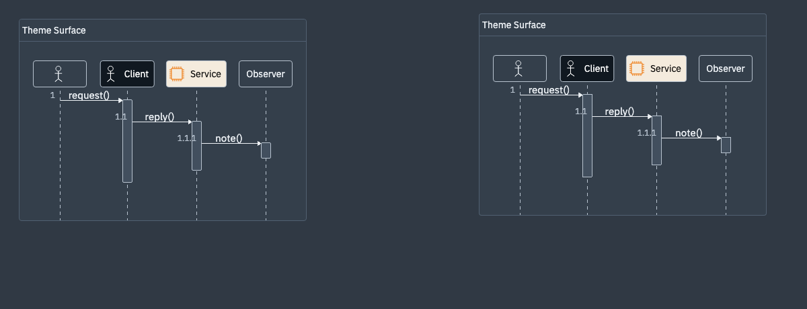
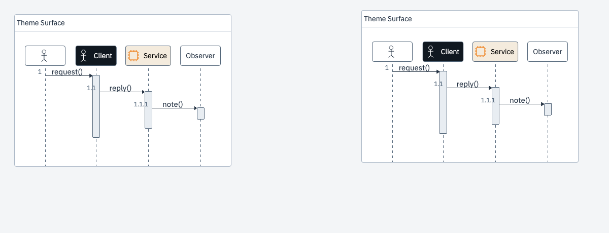
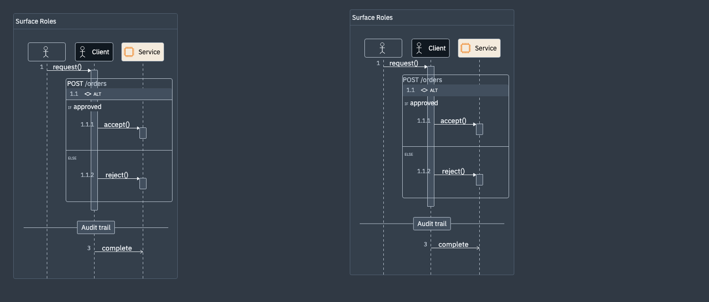

# Core theme surface evidence

## Cause and boundary

The core styles the diagram document, while the host owns the viewport around it. HTML can read its computed canvas color, but a native SVG renderer cannot consume arbitrary host CSS. Without an opaque viewport surface, native SVG corners and host gutters can expose a different background from the diagram. The core therefore exposes the effective canvas color; the host applies it to its own container or iframe. Native rendering receives an explicit palette and serializes a viewport canvas rectangle.

The additive API is `Config.palette` for HTML and `RenderOptions.palette` for native rendering, both using `DiagramPalette` (`canvas`, `content`, `pocket`, `border`, `text`, `secondaryText`). Palette values are opaque `#RRGGBB`. After `await render(...)`, HTML callers can read `getCanvasSurface()`, while native callers read `RenderResult.surface.backgroundColor`. Re-read the HTML snapshot after stylesheet or system-theme changes. Hosts that follow the system theme resolve `matchMedia` to a concrete palette. Calls coalesced during rendering resolve when the latest requested render commits.

The canonical `theme-dark` canvas remains `#1f1f1f`; HTML's implicit default theme behavior remains separate and unchanged. WebSequence can provide SoftDark (`#303944` canvas) from the host. The responsibility boundary remains: the host owns the viewport and system-theme policy; the core owns document palette mapping and returns the surface color needed by the host.

## Visual examples

## Snapshot review

The Darwin visual snapshot review found six localized differences. Geometry was unchanged in all cases, and each changed region and crop was visually inspected. All six post-update diff and crop outputs were byte-identical to the reviewed originals:

| Snapshot | Reviewed difference |
| --- | --- |
| `dark-svg-smoke` | 10 corner pixels changed to the canvas surface. |
| `dark-svg-demo3-nested-fragments` | 12 corner pixels changed to the canvas surface. |
| `dark-svg-fragment-issue` | 12 corner pixels changed to the canvas surface. |
| `dark-svg-demo1-smoke` | 126 pixels total: corner surface pixels and the red participant label at `(624, 72)` changed from `#222` to white. |
| `svg-demo1-smoke` | 110 pixels from the red participant label changing from `#222` to white. |
| `svg-fragment` | 9 pixels from participant C's red label at `(392, 584)` changing from `#222` to white. |

No HTML baselines were updated; the implicit default theme regression was fixed. Linux equivalents still need CI artifact inspection.

## Validation

- `bun run eslint`: 0 errors, 5 existing warnings.
- `bun run test`: 2,061 passed, 3 existing skips.
- `PORT=14017 bun run pw -- --workers=4 --reporter=line`: 287 passed.
- Typecheck: passed.
- `bun run build`: passed (exit 0).
